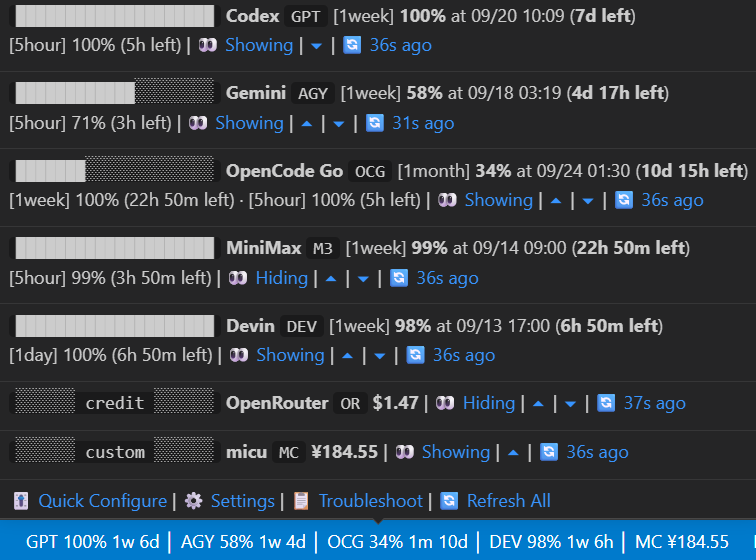

# Lean Quota Monitor

**One status bar. All your AI quotas.**

Lean Quota Monitor is a small VS Code extension that keeps current AI subscription quota and credit state in the Status Bar. Provider acquisition currently supports **Linux / Remote WSL**, **native Windows (Beta)**, and **macOS partial Beta** Extension Hosts. macOS currently supports Codex and AGY; Claude subscription quota is not enabled there because Claude Code stores its credentials in macOS Keychain.



```text
GPT 99% 1w 6d │ AGY 98% 1w 3d │ M3 99% 1w 23h │ OR $74.75
```

Quota providers show the remaining percentage, window type (`5h`, `1w`, `1m`), and reset countdown. Credit providers show **Remaining Credit**. Each quota provider presents one window at a time — its **Primary Window** (the longest duration by default). When any other window drops to or below the **Low Quota Warning Threshold** (default `20%`, or `off`), the Status Bar preempts to that window with a `⚠️` marker until it recovers.

## Built-in Providers

| Company | Provider | Status Bar | Setup authority | Notes |
| --- | --- | --- | --- | --- |
| OpenAI | Codex | `GPT` | Local Codex login | 5h limit officially lifted for now |
| Anthropic | Claude | `CLA` | Local Claude Code OAuth login | |
| Google | Gemini / Antigravity | `AGY` | AGY CLI `/quota` | |
| MiniMax | Token Plan | `M3` | Token Plan API Key in VS Code SecretStorage | |
| Moonshot AI | Kimi Code | `KIMI` | Kimi Code API Key in VS Code SecretStorage | |
| Z.AI | GLM Coding Plan | `GLM` | Coding Plan API Key in VS Code SecretStorage | |
| OpenRouter | Credit | `OR` | Management Key in VS Code SecretStorage | |
| Anomaly | OpenCode Go | `OCG` | Go API Key in VS Code SecretStorage | 5h / 1w / 1m windows |
| DeepSeek | Balance | `DS` | API Key in VS Code SecretStorage or `DEEPSEEK_API_KEY` | |

Exact acquisition and normalization contracts live in [`docs/provider-acquisition-spec.md`](docs/provider-acquisition-spec.md).

## Using the monitor

Clicking the Status Bar opens the monitor — a single menu with everything:

```text
Built-in / Custom providers
→ current value · window · visibility
→ per-provider refresh button
→ click a provider: show or hide · rename · status-bar name
  · API key · primary window · troubleshoot (when errored)

Menu actions
→ Add Custom Provider
→ Refresh Interval
→ ⚠️ Low Quota Warning Threshold
→ Status Bar Alignment
→ Troubleshoot Providers
```

Hover shows the full per-window breakdown plus Refresh All, Quick Configure, Settings, Troubleshoot, reorder arrows, and show/hide controls.

## Provider setup

For first-time setup of extension-owned keys, if the Provider is not visible, open **Troubleshoot**, choose the Provider and its setup method, then use the direct **Set / Replace Key** action. Once the Provider is working, open the monitor and choose the Provider to replace its key or change its display settings — including the **Primary Window** shown on the Status Bar.

| Provider | Setup method |
| --- | --- |
| MiniMax | MiniMax Token Plan API Key |
| Kimi | Kimi Code API Key |
| Z.AI / GLM | Z.AI Coding Plan API Key |
| OpenRouter | OpenRouter Management Key |
| OpenCode Go | OpenCode Go API Key |
| DeepSeek | DeepSeek API Key |

The raw key is stored in VS Code `SecretStorage`; it is not written to normal settings or logs.

Codex, Claude, and AGY reuse their existing local login/CLI authority. Troubleshoot shows the actual file or executable lookup used by the current Extension Host.

Detailed recovery behavior is documented in [`docs/troubleshooting.md`](docs/troubleshooting.md).

## Custom Providers

Custom Providers are lightweight local status sources:

```text
Monitor menu
→ Add Custom Provider
```

Each Custom Provider has:

```text
Provider Name
Status Bar Name
Script Path
```

The extension executes the Script Path directly with no shell command/argument parser. The script must exit successfully and write exactly one non-empty logical line to stdout. That line becomes the opaque **Status Output**.

```bash
echo '$12.30'
```

The Status Bar renders `Status Bar Name + Status Output` with a maximum combined length of 10 Unicode characters. Lean Quota Monitor does not infer quota, credit, currency, percentage, or other semantics from Custom Status Output. Custom Provider credentials remain owned by the script.

Generic examples are available under [`examples/custom-provider/`](examples/custom-provider/).

## Security

[SECURITY.md](./SECURITY.md)

## Contributing

- Human contributors: [`CONTRIBUTING.md`](CONTRIBUTING.md)
- Autonomous AI contributors: [`docs/contribution-prompt.md`](docs/contribution-prompt.md)

## Buy me a coffee ❤️

[GitHub Sponsors](https://github.com/sponsors/nicezic)
